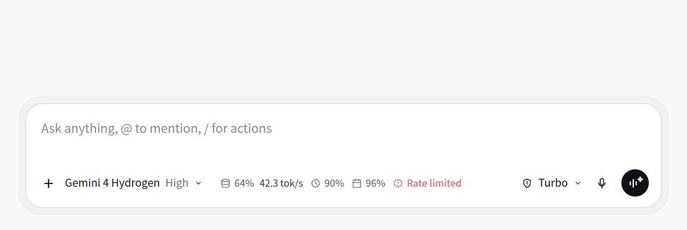

# agy-capsule

[中文](./README.md) | **English**

Context usage, multi-model quotas, cache status and generation speed in the Antigravity composer footer. Hover a capsule to see its panel; click it to pin the panel open.

> This fork also ships [agy-usage](./agy-usage), a minimal footer pill that only shows context tokens and percentage.

<p align="center">
  
</p>

Promo video (v1.1, also on [Bilibili](https://www.bilibili.com/video/BV1ggsy6rEQM/)):

https://github.com/user-attachments/assets/9f5bf1c6-1284-4e17-a380-defdee83f60c

For a simpler footer like 1.0, turn off Generation speed, Last request, Turn metrics, Request failure capsule, and Server queue alert in the sidebar [Settings](#settings). Turn off Context breakdown as well if you only want the key numbers.

## Context

Shows context usage, cache hit rate and cache status. The limit is read live for the current session and model. **Everything below is optional.**

- **Cache expiry alert**: The capsule icon turns yellow at 3 minutes after the last turn and red at 4 by default, meaning the `Cache` has expired. Both thresholds can be customized inline in Settings (up to 998 / 999 minutes). The panel's Cache row updates with it.

- **Context overload alert**: The capsule number turns yellow above 75% and red above 90%.

- **Generation speed**: Shows the speed of this turn's latest request, updated each time a request completes.

- **Speed effects**: A dot that breathes while the model is generating. Red below 10 tok/s, yellow from 10 to under 25, green at 25 and above. After generation stops it keeps its color for 15 seconds, then grays out.

- **Context breakdown**: Splits the context into turn0 (first turn), read, think and write, showing each value and share. Choose rows or columns. Rows can use square or dot markers; columns let you toggle name, value and percent and reorder them.
- **Last request**: Shows the range from first token to the end of the latest request (e.g. `4.5s–8.6s`) and its generation speed.
- **Turn metrics (off by default)**: Shows this turn's elapsed time, requests, thinking and write.

## Quota

Shows the remaining 5-hour and weekly quotas and their reset countdowns for the current pool or all pools.

**Vertex AI (Google Cloud pay-as-you-go):** When no subscription quota is returned and Antigravity confirms the account uses Cloud pay-as-you-go billing, the entire quota capsule is hidden.

**Everything below is optional.**

- **Highlight active model**: Highlights the pool of the selected model and dims the others.
- **Hide absent quota windows (on by default)**: For example, AI Pro users' Argon pool has no 5-hour quota, so that empty window is hidden.

## Error & queue alerts

**Both are optional** and share the third footer capsule (request failures take priority when both are active):

- **Request failure capsule**: Appears in red only when a request fails; hover or click it to see the raw error and an explanation in the panel. Reasons shown: quota exhausted, rate limited (429), disconnected, authentication error, service busy and unknown.
- **Server queue alert**: Appears in amber when waiting for the model's first token during Working exceeds the threshold (default `30s`, configurable `1–999s` at the end of Settings), ticking live while waiting. Scoped to the current turn only, showing `×N` when multiple requests exceed the threshold (e.g. `Queue×2 40s` / `Queue×2`), with per-wait details in its panel. Active local tools and streaming responses do not trigger false alerts.

## Language and appearance

- **Settings language**: English, Simplified Chinese, Traditional Chinese. The language of the settings page.

- **Display language**: English, Simplified Chinese, Traditional Chinese. The language of the panels.

- **Panel height**: Natural height sizes each panel to its content; matched height gives every panel the same height.

- **Panel spacing**: Compact, standard, spacious.

- **Label casing**: Lowercase, title case.

- **Quota indicator**: Ring, bar.

- **Cache indicator**: Icon, ring, bar. Ring and bar fill linearly over time since the last activity, turning yellow then red, and stay full once expired.

- **Reset countdown**: Compact, localized.

## Settings

Open **… → Extensions → agy-capsule** from the conversation header, then switch between the Statistics and Settings tabs at the top.

Preferences live in <code>~/.gemini/config/agy-capsule/settings.json</code> (<code>%USERPROFILE%\.gemini\config\agy-capsule\settings.json</code> on Windows). Updates and uninstalls keep them; options missing from older files fall back to defaults.

## Installation

1. Download or pull this repository, then run the appropriate script:

   | Action | Windows | macOS / Linux |
   |---|---|---|
   | Install | `install.bat` | `sh install.sh` |
   | Update | `update.bat` (pull the latest code first) | `sh update.sh` (pull the latest code first) |
   | Uninstall | `uninstall.bat` | `sh uninstall.sh` |

   Install and update sync to <code>~/.gemini/config/plugins/agy-capsule</code> (<code>%USERPROFILE%\.gemini\config\plugins\agy-capsule</code> on Windows) and remove stale files from older versions. Uninstall removes the plugin directory but keeps your preferences.
2. Enable **agy-capsule** in Antigravity's **Plugins** panel.
3. Open **… → Extensions → agy-capsule** from the conversation header.

After an update the plugin restarts itself and reconnects the sidebar, with nothing to do by hand. The first update from an older version without automatic reload needs one manual plugin restart.

### What if I move Antigravity on Windows?

Open Antigravity once from its new location, then run `update.bat` again so the plugin picks up the new path. No separate Node installation is needed. If the plugin still fails to start, quit Antigravity completely and reopen it.

### Footer capsule doesn't appear

The footer capsule attaches under the input box through Antigravity's debugging port. Newer Antigravity versions no longer open this port by default. Sidebar stats keep working, the capsule doesn't appear, and the sidebar shows "Footer capsule is off" at the top. To turn the port on:

- **Windows, during install**: after `install.bat` / `update.bat` finishes, it asks whether to add the switch if an Antigravity shortcut doesn't have it yet. Press Enter to accept.
- **Windows, one step**: if you skipped that or the switch was lost later, run this from the repository folder. It adds `--remote-debugging-port=0` to the Antigravity shortcuts on your desktop, Start menu and taskbar. Add `-Undo` to revert.

  ```powershell
  powershell -ExecutionPolicy Bypass -File scripts\enable-cdp.ps1
  ```
- **Windows, by hand**: add ` --remote-debugging-port=0` to the end of the shortcut's **Properties → Target**.
- **macOS launcher icon (no Terminal needed each time)**: see the [macOS setup guide](./docs/macos-cdp.md#english) to create a one-time Automator or Shortcuts launcher (or start once from Terminal with `open -a Antigravity --args --remote-debugging-port=0`).

Afterwards, **quit Antigravity completely** and open it from a shortcut. These launches skip the shortcut and won't carry the switch: an `antigravity://` link or Explorer's "Open with Antigravity" when no Antigravity window is open; Antigravity restarting itself after an auto-update; an update installer recreating the shortcuts (run the script again).

> **The capsule disappeared after an Antigravity update — do I need to update agy-capsule?**
> **No.** Antigravity's auto-update restarts itself without going through your shortcut, so the debugging port isn't open for that launch. Just **quit Antigravity completely and reopen it from your shortcut** to restore the capsule. Once the capsule has worked on your machine before, agy-capsule recognizes this automatically: the sidebar banner clarifies no plugin update is needed (on Windows it also checks whether the installer wiped your shortcut switch and offers a one-click restore button), and an optional one-shot desktop notification alerts you once per launch (on by default in Settings).

The port only listens on this computer. While it's open, other programs on this computer can also control Antigravity windows through it; older Antigravity versions opened it by default anyway.

## Metric definitions

- **Generation speed** = total output ÷ (TTFT + streaming time). It includes the wait for the first token.
- **Last request** covers only the most recent model request, not the whole turn; missing values show `—`.
- **Turn metrics** start at your latest message; elapsed time includes queueing, waiting and tool execution.
- **Cache expiry alerts are only a guide**: the cache state (yellow at 3 minutes, expired at 4 by default; configurable in Settings) is estimated locally from the time since the last turn; actual cache hits depend on the server.
- **Server queue alert**: combines recorded per-turn request TTFTs with live pre-first-token waiting time while working (excluding active local tools and streaming responses), resetting automatically on each new user message.

<details>
<summary>Details</summary>

**Last request**

- The speed's numerator is total output: response (including tool-call instructions) plus thinking. Incomplete or zero timings produce no speed.
- TTFT and streaming time come from Antigravity's records, and request duration is their sum, excluding tool execution. TTFT's timer start and first-token boundary are unverified, so it is not a prefill-only measurement.

**Turn metrics**

- Starts at the latest sent user message, including queueing; each new message resets the totals.
- Elapsed time uses wall-clock boundaries, including waits and tools. It advances locally while running and freezes at a known end; if a cancellation has no clear timestamp it shows unknown.
- Requests include recorded retries, excluding pure preflight and injected responses; unrecorded backend calls are not guaranteed to be covered.

</details>

## Development tests

Run the Node tests from the repository root. Playwright is not required:

```sh
node --test "test/*.test.mjs"
```

Browser regression tests are optional. With Playwright and Chromium installed, run `node test/browser-regressions.mjs` separately.

## Contributing

Issues and pull requests are welcome. See the [contribution guide](./CONTRIBUTING.md#english).

## Notices

1. **Inspired by @z21100644 ([PR #1](https://github.com/Lumidarin/agy-capsule/pull/1))**: Thanks for the ideas behind multilingual support, parts of the panel design, click-to-pin, active-model highlighting, generation metrics and speed effects, consistent `K` / `M` token formatting, cache and quota tooltips, context overload alerts, request error classification, and hiding absent quota windows. This version also drew on style isolation, SQLite read caching, incremental CDP updates, installation and maintenance, and Sidecar auto-reload, reimplemented to fit this project. It does not include seven-category context estimates or attachment scanning. Separate settings and display languages, independent appearance controls, the request failure capsule, the new footer's collapse order, turn metrics, and Sidebar interactions were designed separately for this release.
2. **Inspired by @Krwaby123 ([PR #2](https://github.com/Lumidarin/agy-capsule/pull/2))**: Thanks for reporting quota panel overflow with page-translation extensions and proposing shared column alignment with widths that adapt to longer translations. This version uses a different grid across quota groups and marks percentages and countdowns as not translatable. Chinese countdowns are still available in Settings.

## License

[MIT](./LICENSE)
