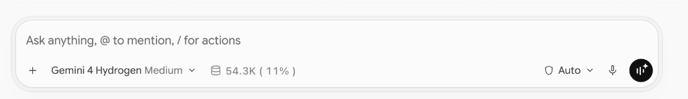

# agy-usage

Antigravity 输入框底栏的极简上下文用量与百分比监控插件，直接读取本地会话数据库并实时展示当前会话的 Token 占用情况。

  

## 功能

- **极简内联显示**：嵌入 Antigravity 输入框底栏（紧邻模型选择器），实时显示当前会话的上下文 Token 用量与占比，如 `54.3K ( 11% )`（新会话显示 `0 ( 0% )`）。
- **本地数据库直读**：以只读模式读取本地 `~/.gemini/antigravity/conversations/` 下的会话 SQLite 数据库，解析 `gen_metadata` 中的最新上下文 Token 数与模型上下文上限，并通过文件/WAL 签名缓存减少重复读取。
- **悬停精确数值**：鼠标悬停在用量胶囊上可查看完整的精确 Token 数与上下文上限（如 `54,321 / 500,000 tokens`）。
- **窄屏自适应折叠**：通过 `ResizeObserver` 监听底栏宽度，空间不足时自动退让——先隐藏数字仅保留图标，空间极窄时自动隐藏，避免与底栏其他控件重叠。
- **昼夜自适应 & 零侵入挂载**：复用宿主 CSS 变量自动适配浅色/深色主题；通过原生 Sidecar 与本地 CDP（`DevToolsActivePort`）注入页面，不修改客户端源码，支持 macOS、Windows 与 Linux。

## 安装

1. 将 [`agy-usage`](./agy-usage) 文件夹复制到 Antigravity 插件目录：
   - **Windows**: `%USERPROFILE%\.gemini\config\plugins\agy-usage`
   - **macOS / Linux**: `~/.gemini/config/plugins/agy-usage`
2. 在 Antigravity 的 **Plugins** 面板启用 **agy-usage**。

> 原包含多模型配额与 Token 构成明细的版本保留在 [`agy-capsule`](./agy-capsule) 目录中。

## License

[MIT](./LICENSE)
